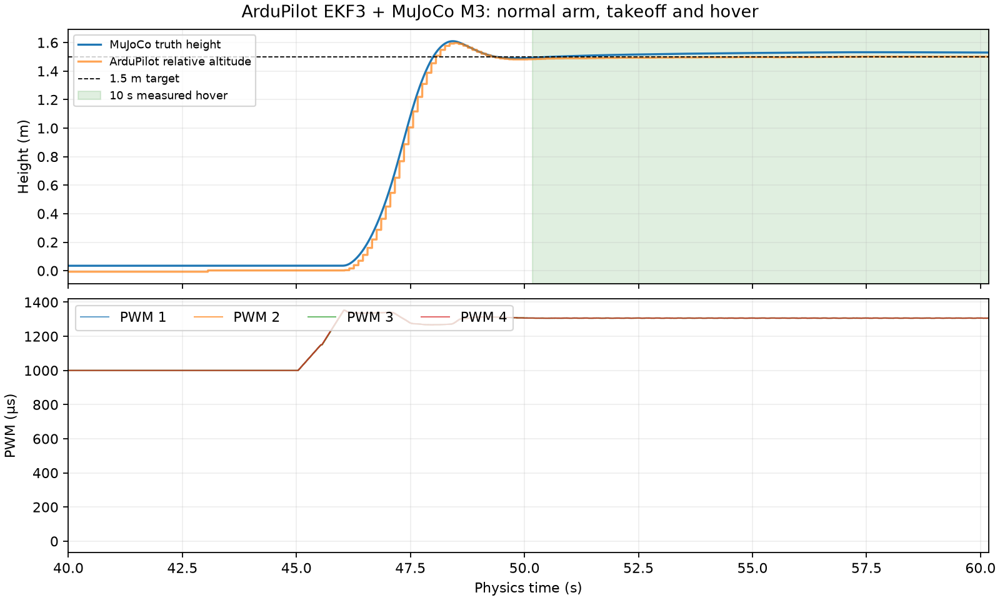

# MuJoCo + ArduPilot SITL Integration Report

Completed 2026-09-10. **All nine gates passed in the actual ArduPilot SITL +
MuJoCo closed loop**, including normal arming, autonomous 1.5 m takeoff and
10 seconds of hover after a two-second settling interval. Two final runs
produced identical recorded PWM and physics histories.

## 1. Baseline audit

Worktree: `/home/shiuhou/Projects/rm27_drones/rm_uav_lab_m600/mujoco_uav_ardupilot`,
branch `ardupilot-m3`, created from verified M3 commit `2be0029`.
The original nested repository remains on `b5afe68`, including its pre-existing
README modification. No original controller, model, sensor or test file changed.
The local ArduPilot checkout remains clean at
`96f98857f7fc4bd564fbbdc43c5f26114246369f`.

[Pre-implementation audit](AUDIT.md) records the design before implementation.
Local source takes priority: `libraries/SITL/SIM_JSON.{h,cpp}`,
`libraries/SITL/examples/JSON/readme.md`, official
`libraries/SITL/examples/JSON/pybullet/robot.py`,
`libraries/AP_Motors/AP_MotorsMatrix.cpp`, and
`libraries/AP_InertialSensor/AP_InertialSensor.cpp` in sibling `../ardupilot`.

The plant uses unchanged `models/quadrotor_m1.xml`: 1 kg, inertia
(0.018, 0.018, 0.030) kg·m², RK4, 0.002 s, gravity (0,0,−9.81) m/s²,
40 ms motor lag, four 8 N maximum-thrust rotors. M3 sensor semantics were
checked against `m3_sensors.py` and `simulator.py`.

## 2. Architecture

All additions are isolated in `ardupilot_bridge/`:

- `protocol.py`: binary servo decoding and JSON framing.
- `frames.py`: world/body basis and quaternion conversion, specific force.
- `actuators.py`: authoritative channel-to-rotor mapping and linear thrust.
- `plant_adapter.py`: direct access to the existing plant, without a custom controller.
- `bridge.py`: frame sequencing, duplicates, restart, one-step lockstep.
- `launch.py`: isolated SITL process, MAVLink flight sequence, logging and benchmark.
- `hover.parm`, `requirements.txt`, `tests/`, audit/report and evidence.

The existing `fly.py`, `simulator.py` and M0–M3 controller/estimator path are
untouched. New flight scope ends at hover; there is no navigation or perception
implementation. The benchmark terminates its own SITL process after measurement;
it does not attempt a landing mission or touch the existing instance 0.

## 3. Protocol implementation

Accept 40-byte `<HHI16H` packets with magic 18458 or 72-byte `<HHI32H` packets
with magic 29569 on the audited little-endian host. Reject bad size, magic,
zero or unsupported steady-state rate before changing physics. Timestamp is
absolute physics seconds. JSON includes timestamp, gyro, accelerometer,
position, velocity and scalar-first quaternion; encoding rejects NaN/Inf.

Replies begin **and** end with newline to satisfy the local two-delimiter
parser. Send to the address/port from which servos arrived. Default physics UDP
port is 9002; benchmark instance 20 uses 9202 and MAVLink TCP 5960.

Identical counters resend the cached response without stepping. Gaps are counted
and make a benchmark fail. Lower counters reset the plant; uint32 wrap remains
continuous. Lifetime diagnostic counters persist across reset, while the plant,
time and per-epoch reply state reset. No wall-clock sleep advances physics.

## 4. Frame conventions and proof

The model specifies body FLU (+X forward, +Y left, +Z up). Assign world +X north,
+Y west, +Z up (NWU); this is an explicit geographic assignment to its arbitrary
horizontal axes. ArduPilot uses body FRD and world NED.

For both bases, `C = diag(1, −1, −1)`. Vectors transform as `v_AP = C v_MJ`;
attitude transforms as `R_AP = C R_MJ C.T`. Quaternion conversion uses MuJoCo
quaternion-to-matrix and matrix-to-quaternion functions. Both endpoints use WXYZ.
Positive MuJoCo roll remains positive; pitch and yaw reverse. Positive X stays
north, positive Y becomes negative east, and positive Z becomes negative down.

Tests cover level pose, all translation axes, each signed rotation axis at
0.3 rad, 90° and 180°, a composed quaternion, stationary/freefall/accelerating
specific force and rotated attitude. A rotated-body test independently checks
free-joint body gyro against `mj_objectVelocity(..., flg_local=1)`.

## 5. Motor ordering and PWM→thrust mapping

The local Quad-X mixer is authoritative (`AP_MotorsMatrix.cpp:592–600`).

| AP output | Rotor | Rotation | XML actuator | XML index |
|---|---|---|---|---:|
| 1 | Front right | CCW | rotor_fr | 1 |
| 2 | Rear left | CCW | rotor_rl | 3 |
| 3 | Front left | CW | rotor_fl | 0 |
| 4 | Rear right | CW | rotor_rr | 2 |

`u = clip((PWM − 1000) / 1000, 0, 1)`; commanded thrust = `8 u` N.
Existing XML order is FL, FR, RR, RL. Thrust acts along local +Z; yaw torque
coefficients in XML order are +0.018, −0.018, +0.018, −0.018 N·m/N.
Single-rotor physics tests prove the resulting AP roll/pitch/yaw torque signs.

Only the existing MuJoCo 40 ms `filterexact` lag is applied. `MOT_THST_EXPO=0`
and battery compensation is disabled to match linear thrust. PWM limits are
explicit. With spin minimum 0.15 and maximum 0.95, the nominal normalized hover
setting is `(9.81/32 − 0.15)/(0.95 − 0.15) = 0.195703125`; hover learning is off.
No controller gains were tuned to obtain flight. Logged command thrust and
actual actuator force are separate quantities.

## 6. Timing / lockstep design

**Observed startup exception:** `SIM_Aircraft.h` initializes its rate to 1200 Hz.
Even with `--rate 500` and `SIM_RATE_HZ=500`, frame 0 advertises 1200 Hz. The
bridge advances one 0.002 s step and returns that timestamp. Local JSON timing
then negotiates 500 Hz. Each final run recorded exactly one 1200 Hz startup
packet followed by 30,087 packets advertising 500 Hz. Only frame 0 is allowed
this exception, including its retries and SITL restarts.

The local INS arming check requires gyro backend rate ≥1.8×controller loop rate.
500 Hz fails the default 400 Hz controller requirement of 720 Hz, and its
nonintegral clock division also produced slow-loop warnings. `SCHED_LOOP_RATE=250`
solves both: two physics samples per controller cycle, with all arming checks
still active. `ARMING_SKIPCHK=0` is verified via MAVLink before arming.
This is a documented timing/configuration change, not an upstream source change.

Each new servo packet still causes exactly one 0.002 s MuJoCo step. Simulator
speedup changes wall time only. The benchmark sends GCS heartbeat and flight
commands according to physics time. EKF3 is active; neither truth AHRS nor
`no_time_sync` is used.

## 7. IMU semantics

Accelerometer output is `C R_MJ.T (a_world − g_world)`, matching the verified
M3 concept. At rest and level, AP reads (0,0,−9.81) m/s²; in freefall it reads
approximately zero. `qacc[:3]` is free-joint world linear acceleration.
`mj_forward` after integration synchronizes derived dynamics to the returned
pose. Body gyro comes from free-joint rotational velocity, converted to FRD.
No M3 noise, latency, bias, dropout, optical flow or range measurements are added.
ArduPilot's ordinary simulated GPS/barometer/compass feed EKF3 for this milestone.

## 8. Reset semantics

`mj_resetData` restores qpos/qvel, actuator activation/controls and time;
`mj_forward` reconstructs derived dynamics. There is no persistent derivative
sensor buffer. The reply cache is invalidated and a new epoch is logged.
Tests compare restart output and qpos/qvel/qacc/act/ctrl against a fresh bridge,
including an initial 1200 Hz restart packet. Duplicate and rollover cases are
also tested. Live SITL reboot recovery is not separately flight-tested.

As in the official example, a lower counter is treated as restart. A delayed
out-of-order UDP packet is inherently ambiguous without a session identifier;
this implementation targets the audited localhost lockstep setup. It is not a
claim of robust WAN or multi-controller operation.

## 9. SITL startup procedure

From the isolated worktree, using the existing environment:

```bash
cd /home/shiuhou/Projects/rm27_drones/rm_uav_lab_m600/mujoco_uav_ardupilot
/home/shiuhou/venvs/mujoco/bin/python -m pip install -r ardupilot_bridge/requirements.txt
/home/shiuhou/venvs/mujoco/bin/python -m ardupilot_bridge.launch \
  --ardupilot ../ardupilot --instance 20 --speedup 5 \
  --output ardupilot_bridge/artifacts/new-hover-run
```

Use a new output directory; the launcher refuses to overwrite previous evidence.
It starts the already built local `build/sitl/bin/arducopter`, loads official
copter and copter-X defaults then `hover.parm`, wipes only the new output
directory's SITL EEPROM, and owns cleanup of that process. Metadata records the
exact binary command and SHA-256. Startup and physics/wall-time deadlines fail
with a nonzero exit code and retained logs.

For a separately managed default instance, start the standalone bridge with
`python -m ardupilot_bridge.bridge --port 9002 --log bridge.jsonl` and launch
`sim_vehicle.py -v ArduCopter -f X --model JSON:127.0.0.1 --add-param-file <absolute-path>/ardupilot_bridge/hover.parm`.
Use `-f X`, not `-f quad`: local `quad` defaults select Plus geometry.
The automated launcher above is the tested procedure.

Test environment: Python 3.12.3, MuJoCo 3.12.0, NumPy 2.5.1,
pymavlink 2.4.49; ArduCopter identifies itself as V4.8.0-dev (96f98857).

## 10. ARM / TAKEOFF / HOVER results

[Run 1 summary](evidence/hover-1-summary.json),
[run 2 summary](evidence/hover-2-summary.json),
[repeatability proof](evidence/repeatability.json).

| Gate / event | Evidence, run 1 physics time |
|---|---|
| Protocol, frames, mapping | Unit and rotor physics tests pass |
| Continuous JSON exchange | 30,088 frames, zero gaps/duplicates/resets/invalid packets |
| Ready | `ArduPilot Ready`, 1.930 s |
| EKF3 active | `AHRS: EKF3 active`, 3.936 s |
| GUIDED | Command 176 accepted, 15.008 s; confirmed by heartbeat |
| ARM | Command 400 accepted, 43.030 s; armed heartbeat 43.048 s |
| TAKEOFF | Command 22 to 1.5 m accepted, 45.024 s |
| Measured hover | 50.176–60.176 s, after two-second settling interval |

Both runs measured:

- Hover altitude: **1.493837–1.532266 m**.
- Maximum hover speed: **0.020796 m/s**.
- Maximum hover tilt: **0.086964°**.
- Maximum horizontal distance from origin in hover: **0.063962 m**.
- Whole-run peak altitude: 1.609775 m; peak tilt: 0.143461°.
- Final AP mode GUIDED, armed true, relative altitude 1.501 m.
- No NaN, flip, runaway or unexpected disarm; no communication gaps.

The benchmark's broad hover acquisition band is 1.5±0.3 m and |vertical speed|
<0.3 m/s, held for two seconds before the ten-second observation. Independent
failure guards detect >45° tilt, >5 m height, >10 m horizontal runaway,
nonfinite truth, stale heartbeat, unexpected disarm or mode change. These are
initial milestone guards, not newly claimed tight positioning specifications.

The two complete recorded frame-count/PWM/state/truth streams have identical
SHA-256 `1218a5b380253f427ae1baf43a87706f198ddd63aa8e2f6ca7a871aadf9da56c`.
This establishes repeatability for the tested machine/configuration, not every
future ArduPilot or MuJoCo version.



Full per-frame and MAVLink logs, parameters and native SITL logs are retained in
[run 1 artifacts](artifacts/hover-1/) and [run 2 artifacts](artifacts/hover-2/).
Large raw artifacts are gitignored; compact summaries and proof are provided in
`evidence/`. Every physics row includes frame count/rate, PWM 1–4, truth position,
velocity/quaternion/body rates, command/actual thrust, complete IMU/state sent,
and latest AP mode/armed/altitude observations with heartbeat age information.
MAVLink observations retain their own physics receipt timestamps; they are not
misrepresented as 500 Hz telemetry samples.

## 11. Exact test commands/results

Commands below ran from the isolated worktree with
`/home/shiuhou/venvs/mujoco/bin/python`:

| Command after interpreter | Result |
|---|---|
| `-m pytest -q` (unmodified baseline) | 134 passed, 86.29 s |
| `-m pytest ardupilot_bridge/tests -q` (final new suite) | 40 passed, 0.46 s |
| `-m pytest tests ardupilot_bridge/tests -q` (before final added rotated-gyro test) | 173 passed, 85.74 s |
| `-m ardupilot_bridge.launch --output ardupilot_bridge/artifacts/hover-1` | Exit 0, all flight gates pass |
| `-m ardupilot_bridge.launch --output ardupilot_bridge/artifacts/hover-2` | Exit 0, same physics history |

The initial protocol/frame/mapping tests failed during collection because the
implementation did not exist, then passed after implementation (TDD). Final
suite additionally covers actuator dynamics, torque signs, malformed/rate
rejection, reset/retry/wrap behavior, body gyro and required parameter checks.
No existing tests were weakened. Test logs reside in `artifacts/regression/`.

## 12. Existing M0–M3 regression results

All original test cases remain passing. Each original standalone benchmark also
ran successfully with the same interpreter:

```bash
python m0_benchmark.py   # PASS
python m1_benchmark.py   # PASS
python m2_benchmark.py   # PASS
python m3_benchmark.py   # PASS
```

Exact stdout and generated reports are saved in `artifacts/regression/`.
Generated baseline JSON files were restored to their original tracked contents
after saving this new evidence. `git diff --exit-code` confirms all tracked M3
files remain unchanged. The existing M2/M3 benchmark missions were run only as
regressions; no new AP navigation capability was implemented.

## 13. Failures and root causes

1. First attempt rejected initial 1200 Hz packet despite 500 Hz parameters.
   Root cause: local Aircraft startup rate precedes JSON timestamp negotiation.
   Fixed with a frame-0-only exception and tests, not a variable physics step.
2. Second attempt connected, reached Ready/GUIDED and EKF3, but normal arming
   failed: `Gyro 0 rate 500Hz < loop rate*1.8 720Hz` and slow main-loop warnings.
   Fixed by explicit 250 Hz controller scheduling; no arming checks bypassed.
3. Source audit found README retry timing differs from code (~1.1 s actual),
   the parser benefits from both newline delimiters, and the official PyBullet
   rotor-4 position appears duplicated. The bridge follows the local parser
   and AP motor mixer rather than copying those defects.

[First failure](evidence/initial-1-summary.json) and
[second failure](evidence/initial-2-summary.json) are retained. No flight was
claimed for either failed attempt. Existing binaries were reused; no ArduPilot
source or build changes were necessary.

## 14. Remaining Sim-to-Real gaps

This is a nominal 1 kg simulation plant with linear thrust and clean bridge IMU.
Motor/ESC curves, battery behavior, actual geometry/inertia, sensor calibration,
noise/delay, vibration, wind/ground effect and hardware timing are not calibrated
against real hardware. Flight uses simulated GPS-backed EKF3, not GPS-denied
M3 localization. No optical flow, ToF, vision, RM task, interception or hardware
integration is provided. Lower-counter reset is unit-tested; live reboot and
network impairment flight campaigns remain future work.

## 15. Recommendation for the next milestone

First preserve this nominal flight as the regression gate. Next characterize
closed-loop repeatability under controlled timing/restart and modest plant/sensor
perturbations, then define measured acceptance bounds before adding new sensing
or missions. This report does not implement that future milestone.
