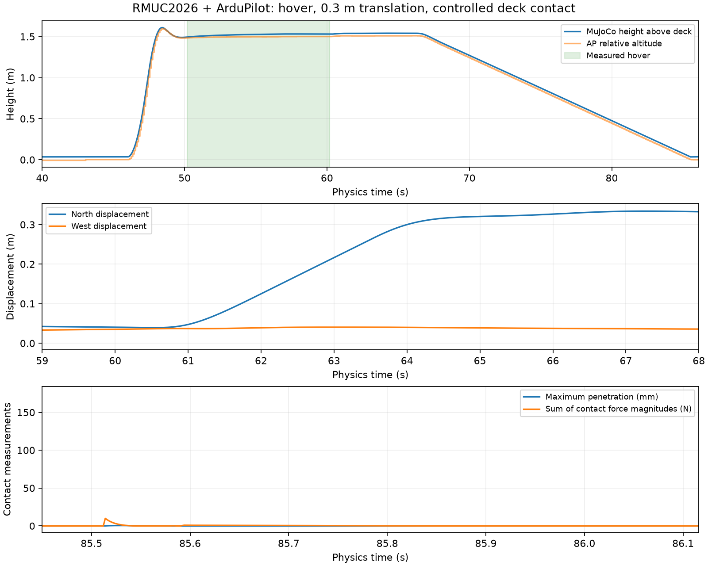

# RM27 G1' Native-MJCF Field Integration Report

**G1' passed for the bounded experiment below.** Actual ArduPilot SITL controlled
the original UAV inside the complete native RMUC2026 model through normal ARM,
1.5 m takeoff, ten-second hover, a 0.3 m translation and controlled deck contact.
Both full field runs passed. Recorded motor-input replay is deterministic;
the two closed-loop runs differ during descent, as quantified in section 9.

This does **not** certify the field as a complete aerial collision environment.
Upstream deliberately omits many features above its ground-robot contact band,
and some README fidelity commands are stale. Those limits are detailed below.
No Gazebo conversion, perception, moving target or G2 work was performed.

## 1. Battlefield source audit

Source: sibling `../rmuc2026_battlefield_mjcf/model.xml`. Read the full collision
architecture in `tools/README.md`, checker sources, asset layout and saved
validation outputs. [AUDIT.md](AUDIT.md) records the pre-implementation design.

The source compiles without missing assets under MuJoCo 3.12.0:
4 bodies including world, 555 geoms, 428 colliders, 127 visual-only geoms, no
joints or dynamic field bodies. The analytic floor is 29.05 × 16.05 × 0.2 m,
centred in XY, with top Z=0. This floor extent is not a claim about every
outer decoration's bounds.

The main field body offset is (-0.02, -1.624344, 1.641344). Separate replacement
decks are centred at (-9.55,3.75,0) and (8.35,-3.71,0), with top Z=0.5 m.
The source includes a site, lights and an overview camera; these coexist with
the UAV but no rendered sensor or perception pipeline is enabled.

## 2. Upstream commit and licensing status

Audited commit: **dcf1202f04e1ba31ab5dffac6b2c1c26f1129453**.
Model SHA-256: `2742814c2a10a81ecdd27200e462f21a34406c5eca97cfce7da37a2ee16812c9`.
Reference repository: CosmosMount/rmuc2026_battlefield_mjcf.

No tracked LICENSE/COPYING file was found. Assets remain in the sibling repository;
none are vendored or redistributed by this integration. Generated composition
XML in ignored run artifacts references absolute source asset paths. It is
regenerated locally rather than used as a portable asset bundle.

Upstream tracked files and the original `quadrotor_m1.xml` remain unchanged.
An untracked upstream `.venv/` appeared during the session; this implementation
neither creates nor modifies that environment. Tests use `/home/shiuhou/venvs/mujoco`.

## 3. Collision model architecture

Source collision is 17 boxes and 411 convex meshes: analytic ground, partitioned
support surfaces, thin barrier shells, central braces/platforms, ramp side
walls, side-highland repairs, undulating roads and replacement stepped decks.
All 428 field colliders are retained, along with all 127 visual geoms.

Visual group 2 has contype=conaffinity=0. Collision group 3 uses masks 1/1,
friction (0.8,0.01,0.001), solref (0.01,1), solimp (0.95,0.99,0.001).
Source per-geom overrides remain intact. Contact parameters are not weakened.

Many source surfaces are restricted to Z≤1 m; entirely higher features can be
visual-only. The later roads and decks have their own explicit geometry. A UAV
hovering at 1.5 m must not infer that every visible overhead structure will
collide. No collision is invented for omitted geometry.

## 4. Existing upstream validation reproduced

Unchanged C++ sources were compiled against installed MuJoCo 3.12.0. Source
benchmarks used 3.4.1. The first compile failed because 3.12 ray functions add a
normal-output argument; `ray_compat.hpp` supplies `nullptr` without editing
upstream code or changing what the tests measure.

| Native checker | Actual result |
|---|---|
| Commanding heights | 100 checks, 0 failures; max height error 6.66e−16 m |
| Undulating roads | 6,060 samples, 0 failures; visual/collision difference 0; arc error 0.2512 mm |
| Ramp/barrier crossings | All 22 cases pass, including repaired highland walls |

These checks use the native model's `implicitfast`. Integration probes separately
exercise the composed model under the UAV's RK4 settings.

Two documented Python audits were also reproduced, with explicit output paths
outside upstream and bytecode writing disabled:

- Current support audit: 96.960% within 2 cm; false-solid area 8.493 m²;
  missing-support area 4.245 m². This differs from older README figures.
- Current barrier command: 564 samples, 428 hits, 136 misses; only 47.518%
  within 1 cm. **This is not reported as a pass.**
- The identical barrier command against historical `ebdabc0` gives 302/302 hits,
  100% within 1 cm, matching the README. Current visual mesh 47 is an R-replaced
  mesh, so the old component indices no longer identify the same surfaces.
  Mesh 38 also changed; new roads/decks are not the old single support shell.

The Python audit exits with code 0 even when it reports misses, so exit status
alone is not treated as evidence of fidelity. These stale aggregate checks need
upstream revision before their current-model figures can serve as release gates.
Logs are retained in [evidence/](evidence/) and raw `artifacts/upstream/`.

## 5. Composition architecture

`field_adapter.py` parses both source XML trees and produces one in-memory model.
It preserves all field world transforms; imports named defaults, assets,
static bodies, lights and camera; resolves each mesh path; and rejects naming
conflicts or unsupported source root sections. UAV angle attributes are converted
from degrees to radians before merging into the field's angle convention.

The UAV XML is authoritative for global physics: **RK4, dt=0.002 s, gravity
(0,0,−9.81), density 1.2, viscosity 1.8e−5**. Field `implicitfast` does not override
it. Only the original empty-world ground is removed. The UAV remains 1 kg,
inertia (0.018,0.018,0.030), original rotor sites/gears/ranges and 40 ms motor lag.
No controller gains or autopilot parameters changed.

The final model contains **5 bodies, 563 geoms, 432 colliders, 7 qpos, 6 qvel
and 4 actuators**. Compiled-model tests compare every field geom's pose, size,
type, masks and contact parameters, and compare original UAV inertia, actuator
settings, rotor sites and physical geoms by name.

Minimal existing-code changes: `Bridge` accepts an optional plant; the existing
flight runner accepts an optional bridge and post-hover experiment. Its guards
use the already-transmitted local position instead of absolute field position.
Without those arguments it still performs the original standalone hover test.

## 6. Coordinate/frame contract

Field coordinates are metres and Z-up. The source specifies plan-view +X right,
+Y up but no geographic north. **FIELD = MuJoCo world at identity.** The existing
bridge convention assigns +X north, +Y west, +Z up; no field rotation or
translation is applied.

`safe_test_spawn` navigation origin: **(-9.55,3.75,0.5)**, the northwest deck
surface centre. Initial UAV origin is (-9.55,3.75,0.62), retaining the original
0.12 m clearance. Compiled initial contacts = 0; settling later onto the deck
before arming is expected.

Wire position: `p_NED = diag(1,−1,−1) × (p_world − spawn_origin)`.
Velocity, body rate, specific force and attitude use the unchanged bridge basis
conversions. Translation does not alter attitude. Tests prove origin clearance,
axis signs and preserved native field landmarks/transforms.

ArduPilot's EKF/home altitude origin is near the resting vehicle centre, roughly
3.5 cm above the deck surface. Thus MAVLink relative altitude and wire/physical
height above the deck differ slightly. During hover, true local height is about
1.53 m for an AP target of 1.5 m. This distinction matters for contact setpoints.

## 7. Collision integration tests

Eight full-field sphere probes passed without filtering away unrelated field
colliders: floor, central support, launch ramp, northwest deck, lower/upper
central-ramp walls, launch side wall and upper side-highland wall.

The lateral probes start at 0.2 m/s per commanded axis (central diagonal speed
0.283 m/s), remain on the intended side, and hit named intended geoms. Gravity
drops additionally check finite contact, resting stability and support. Their
transient penetration is 11.7–19.2 mm under the inherited soft-contact settings;
this is documented rather than presented as zero penetration. The worst drop
contact force is 469.4 N. Low-speed wall penetration is 1.13–1.62 mm.

No nonfinite state or explosive velocity occurred. The actual UAV's controlled
deck contact provides a separate flying-body test in section 10. These are
representative probes, not proof of collision completeness or high-speed CCD.

Final focused tests: **52 passed** (40 bridge + 12 field integration).
The preceding combined run had **185 passed**, including all 134 original
M0–M3 cases, before one final rotor-geometry preservation test was added.

## 8. MuJoCo performance benchmark

Single-machine measurements; not precision performance claims. No collision
simplification or optimization was performed.

| Configuration / phase | Mean mj_step | p95 | Active contacts | Physics-only RTF |
|---|---:|---:|---:|---:|
| Field alone, native implicitfast | 14.19 µs | 19.16 µs | 0 | 140.90× |
| Full field + resting UAV, RK4 | 78.43 µs | 83.02 µs | 4 | 25.50× |
| Actual field hover, RK4 | 80.31 µs | 119.42 µs | 0 | 24.90× |
| Near controlled contact, RK4 | 81.00 µs | 115.54 µs | mean 0.79, max 4 | 24.69× |

Field-only compile: 0.471 s; composed compile approximately 0.44–0.48 s.
Each idle/resting estimate uses 5,000 measured steps after warmup. Hover uses
5,001 samples; the near-contact window uses 801.

The final full flight advanced **86.118 physics seconds in 23.221 wall seconds**:
**3.709× end-to-end RTF**, with requested SITL speedup 5. This includes process
startup/cleanup, UDP, additional `mj_forward`, sensors and JSON logging, unlike
the physics-only table. The field is fast enough for real-time 500 Hz operation
on this machine; physics-only RTF must not be equated with end-to-end throughput.

## 9. ArduPilot field-flight result

The event table and contact measurements below describe `field-flight-2`.
[Flight summary](evidence/field-2-summary.json),
[field result](evidence/field-2-result.json). The final repeat is separately
recorded in [final summary](evidence/field-final-summary.json).

| Event | Physics time |
|---|---:|
| ArduPilot Ready | 1.930 s |
| Normal armed heartbeat | 43.048 s |
| 1.5 m takeoff requested / accepted | 45.016 / 45.024 s |
| Measured hover, after settling | 50.176–60.176 s |
| Translation complete | 66.180 s |
| Controlled contact | 85.514 s |
| Post-contact observation complete | 86.116 s |

All arming checks remain enabled (`ARMING_SKIPCHK=0`); EKF3 and GUIDED are used.
Physics stays 500 Hz, controller 250 Hz. The runs exchanged **43,058 and 43,059
frames respectively, with zero missing, duplicate, reset or invalid frames**. Only startup
frame 0 advertises 1200 Hz; subsequent frames advertise 500 Hz as before.

Hover true height above the deck: **1.493923–1.532057 m**; maximum speed
0.021123 m/s; maximum hover tilt 0.056102°. No airborne contact during hover.
Translation: 0.3 m requested over the deck, maximum observed speed 0.092346 m/s,
zero contact, final local position (0.32818,0.03759,1.54073) m. This is a fixed
validation setpoint sequence, not mission guidance.

The two full runs are not bit-identical: the first differing PWM and state
occur at frame 33,119 (66.240 s), during descent after identical hover and
translation. Maximum aligned position difference is 0.017794 m. Final-repeat
contact occurs at 85.516 s, with 0.423087 mm maximum penetration and 2.34027 N
maximum single-contact force. Both runs pass. The source of the closed-loop
command divergence has not been isolated; asynchronous command delivery is a
possible explanation, not a demonstrated cause. Full closed-loop bit determinism
is therefore not established.

Replaying all 43,058 PWM frames from `field-flight-2` reproduced every
transmitted state exactly (SHA-256
`38cda2ebc622f0332b6e45c2b1ac0facbd03030be03238510608531aeb7e8636`).
The final run also replays all 43,059 states exactly.
See [repeatability](evidence/repeatability.json), [first replay](evidence/deterministic-replay.json)
and [final replay](evidence/final-deterministic-replay.json).

## 10. Controlled contact result

The original UAV fuselage contacted
`field__collision__commanding_northwest_platform` after an 0.08 m/s commanded
descent. Actual pre-contact world velocity:
**(-0.002307,0.005751,-0.077001) m/s**.

First contact: 85.514 s. Normal from fuselage (geom 0) toward deck (geom 1):
**(0,0,−1)**; the deck reaction on the UAV is upward. Maximum penetration over
the observation: **0.424724 mm**. Maximum force magnitude at one contact:
**2.59514 N**. Maximum tilt: **0.09832°**.

After 0.602 s, world position was (-9.21859,3.78903,0.53663) m and velocity
(-0.00150,0.00234,0.00717) m/s. Attitude and solver remained finite; the UAV was
still armed in GUIDED. Full quaternions, individual contact forces, distances,
normals and geom names are saved in the result and per-frame logs. This short
controlled contact is not a landing/disarm certification or an impact mission.



## 11. Standalone hover regression

The standalone runner passed again on instance 22. Its full physics history
matches the original verified hash exactly:
`1218a5b380253f427ae1baf43a87706f198ddd63aa8e2f6ca7a871aadf9da56c`.
The optional integration hooks therefore did not change this tested baseline.

Comparing the first 30,088 field and standalone frames in their respective
local wire frames gives maximum position difference **0.02519 m**, maximum
height difference **0.003211 m**. Field ground contact uses the real deck's
contact settings and translated geometry, rather than the empty-world floor;
these change the initial settling response and subsequent EKF/controller
history. No mass, inertia, actuator or controller change was introduced.
The airborne hover bounds remain comparable; bit identity between these two
different contact environments is not claimed.

All original M0–M3 test cases passed in the combined regression run. Existing
benchmark/test files and their stored reports were not edited for G1'.

## 12. Problems / mismatches discovered

- Upstream C++ ray API mismatch: resolved with integration-side optional normal
  output shim, retaining unchanged checker sources.
- Stale README component selections: demonstrated by current-versus-`ebdabc0`
  audit results. No geometry was changed to make those numbers look better.
- First highland test aimed at Y=0, outside that wall. Corrected to the upstream
  documented Y=5.6 probe location; no field collider changed.
- First contact flight held about 7 cm above the deck and hit its deadline.
  It passed hover/translation but **not contact**. A positive terminal EKF
  altitude plus the resting-origin offset prevented contact. The final bounded
  descent uses a −3 cm terminal EKF setpoint, then zero after touch; actual
  contact remains governed by physics and is slow. Failed run is retained.
- Source offers incomplete aerial collision and no explicit asset license.
- An initial test compared all sites globally; the field has an extra site.
  The final test compares each original rotor site by name.

## 13. Remaining risks

The experiment validates the tested region and speeds only. Above-band visual
features, omitted small fragments, concave gaps and stale aggregate fidelity
checks remain material limits. No camera, target detector, optical flow, ToF,
moving target, STEP base, multi-UAV or autonomous attack/contact behavior exists.
The UAV remains the nominal 1 kg plant, not calibrated hardware. Performance is
machine-dependent; contact observation is short and low-speed. Upstream 3.4.1
figures should not be treated as our 3.12 measurements.

## 14. Exact reproduction commands

From `/home/shiuhou/Projects/rm27_drones/rm_uav_lab_m600/mujoco_uav_ardupilot`,
use `/home/shiuhou/venvs/mujoco/bin/python` for every Python command below:

```bash
python -m pip install -r rm_world/requirements.txt
python -m rm_world.validate_upstream
python -m rm_world.probes
python -m pytest tests ardupilot_bridge/tests rm_world/tests -q
python -m rm_world.flight --instance 21 --output rm_world/artifacts/new-field-run
python -m ardupilot_bridge.launch --instance 22 --output rm_world/artifacts/new-baseline
python -m rm_world.performance --field-run rm_world/artifacts/new-field-run --baseline-run rm_world/artifacts/new-baseline
python -m rm_world.replay rm_world/artifacts/new-field-run
```

Use new flight output directories. C++ compiler/link commands are captured in
`artifacts/upstream/commands.json`. Dependencies: Python 3.12.3, MuJoCo 3.12.0,
pymavlink 2.4.49; local ArduPilot `96f98857`, existing built SITL binary.
The launcher writes binary SHA-256 and exact command metadata per run.

Reproduced Python audit commands:

```bash
python -B ../rmuc2026_battlefield_mjcf/tools/audit_barrier_fidelity.py ../rmuc2026_battlefield_mjcf/model.xml --visual-component-labels 2,6,8,9,10,11,14,15,16,17,19,20,21,22,23,24,26,27,32
python -B ../rmuc2026_battlefield_mjcf/tools/audit_collision_fidelity.py ../rmuc2026_battlefield_mjcf/model.xml --spacing 0.05 --support-visual-geoms field__visual__38 --exclude-collision-prefixes field__collision__barrier_,field__collision__center_black_,field__collision__center_dark_support_,field__collision__ramp_side_barrier_,field__collision__flight_ramp_barrier_,field__collision__side_highland_upper_ --map rm_world/artifacts/upstream/collision_diff.png
```

The historical diagnostic stages `git show ebdabc0:model.xml` in ignored
artifacts with an external asset symlink, then runs the same barrier command.
No source-generation tools or upstream editing commands are used.

Raw evidence: `artifacts/field-flight-1` (failed contact attempt),
`field-flight-2` and `field-flight-final` (successful), `standalone-regression`,
`upstream`, and test/probe/performance outputs. Compact summaries, logs and plot
are in `evidence/`. Existing Gazebo processes are neither required nor altered.

## 15. Recommendation for G2

Preserve this bounded G1' flight/contact as a regression gate. Before any broader
UAV operation, define and validate the intended aerial collision envelope and
update stale source fidelity selections. G2 may separately audit the proposed
STEP target's units, geometry, licensing and contact envelope; no STEP import
or target behavior was implemented here.
